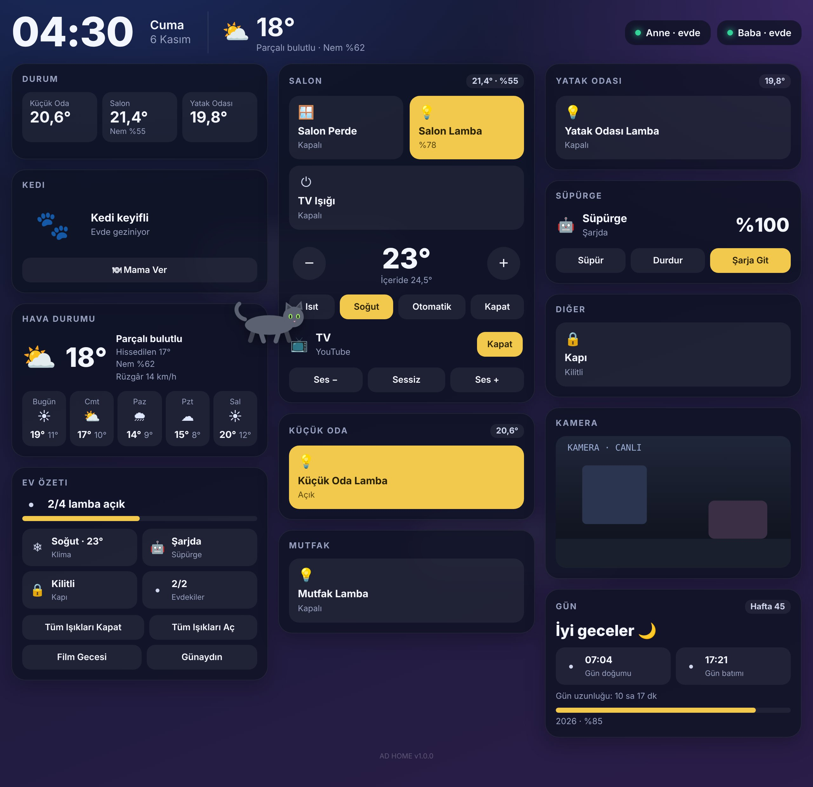
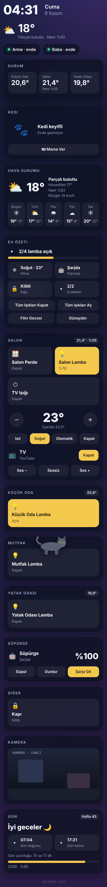

# AD HOME

Tam ekran, koyu temalı, kartlı bir **Home Assistant** dashboard'u. Odalarını ve cihazlarını kendisi bulur, yerleştirir. Panelin üstünde de bir **kedi** gezer: kartların üstünde yürür, yorulunca oturur, gece uyur, 24 saat mama verilmezse "Acıktım" der. 🐾

*Full-screen dark smart-home dashboard for Home Assistant, with a little cat walking on your cards. English below.*



## Özellikler

- **Kurulum 2 dakika:** HACS'tan kur, dashboard ayarına tek satır yaz.
- **Otomatik yerleşim:** Home Assistant'taki **Alanlar** (odalar) okunur, her oda bir kart olur.
- **Lamba, priz, fan:** dokununca açılır, kapanır.
- **Klima:** sıcaklık + / −, Isıt, Soğut, Otomatik.
- **Süpürge:** pil, Süpür, Durdur, Şarja Git.
- **TV:** aç, kapat, ses, sessiz.
- **Perde, kapı kilidi, kamera** görüntüsü.
- **Durum kartı:** bütün sıcaklık sensörleri yan yana, nemleriyle.
- **Hava Durumu kartı:** hissedilen, nem, rüzgâr ve 5 günlük tahmin.
- **Ev Özeti:** kaç lamba açık, klima, süpürge, kapı, evdekiler; tek tuşla tüm ışıkları aç/kapat, sahne kısayolları.
- **Gün kartı:** selamlama, gün doğumu/batımı, gün uzunluğu, hafta numarası.
- **Oda başlıklarında** o odanın sıcaklığı ve nemi.
- **Üst satır:** saat, tarih, hava durumu, evdekiler.
- **Hava efektleri:** arkada bulutlar geçer, yağmur, kar ve şimşek gelir, gece yıldızlar çıkar. Efektler kartların arkasında kalır.
- **Kedi:** panelde gezer, oturur, uyur. İstersen mama makineni bağlarsın, "Mama Ver" tuşu çıkar.
- **Dil:** Türkçe ve İngilizce. Tablet ve telefonda düzgün görünür.

## Kurulum

1. **HACS → sağ üstte ⋮ → Özel depolar (Custom repositories)**
   - Depo: `https://github.com/twitterdoganaybal-create/ad-home`
   - Tür: **Dashboard**
2. HACS'ta **AD HOME**'u ara ve **İndir**'e bas. Sayfayı yenile.
3. **Ayarlar → Dashboard'lar → Dashboard Ekle → Sıfırdan yeni dashboard**. Açtığın dashboard'da sağ üstte **⋮ → Düzenle → ⋮ → Ham yapılandırma düzenleyici**'ye gir, içini silip şunu yaz:

```yaml
strategy:
  type: custom:ad-home
```

Kaydet. Bütün her şey hazır. 🎉

> Bir cihaz görünmüyorsa **Ayarlar → Alanlar** bölümünden onu bir odaya ata.

### Ayarlar (isteğe bağlı)

```yaml
strategy:
  type: custom:ad-home
  lang: tr                          # tr | en
  weather: weather.forecast_home    # boş bırakırsan ilk hava durumu kullanılır
  people: [person.baba, person.anne] # üstte gösterilecek kişiler
  cat: true                         # kediyi kapatmak için false
  cat_name: Kedi                    # kedinin adı
  cat_color: gri                    # gri | siyah | turuncu | beyaz
  cat_feed: button.mama_makinesi    # mama tuşu; son basıştan 24 saat geçince kedi acıkır
  cat_litter: button.kum_temizle    # kum temizleme tuşu
  weather_effects: true             # arka plan hava efektleri
  hide: [light.gizli_lamba]         # gösterilmeyecekler
  names:                            # görünen isimleri değiştir
    vacuum.roborock_s7: Süpürge
    camera.salon_cam: Kamera
```

Sadece kart olarak kullanmak istersen `type: custom:ad-home-card` yaz, aynı ayarlar geçerli. Cihazın yoksa önce `demo: true` ile örnek evi görebilirsin.

---

## English

**AD HOME** is a full-screen dark dashboard for Home Assistant. It reads your **Areas** and builds a card for every room automatically. Lights, switches, climate, vacuum, TV, covers, locks, cameras and temperature sensors are all supported, with animated weather in the background and a cat that walks on your cards.

**Install**

1. HACS → ⋮ → *Custom repositories*: add `https://github.com/twitterdoganaybal-create/ad-home` as **Dashboard**.
2. Download **AD HOME** and refresh the browser.
3. Create a new dashboard, open the *Raw configuration editor* and paste:

```yaml
strategy:
  type: custom:ad-home
  lang: en
```

All options from the Turkish section above work the same (`cat_color`: `gri` grey, `siyah` black, `turuncu` orange, `beyaz` white).



## Lisans / License

MIT
